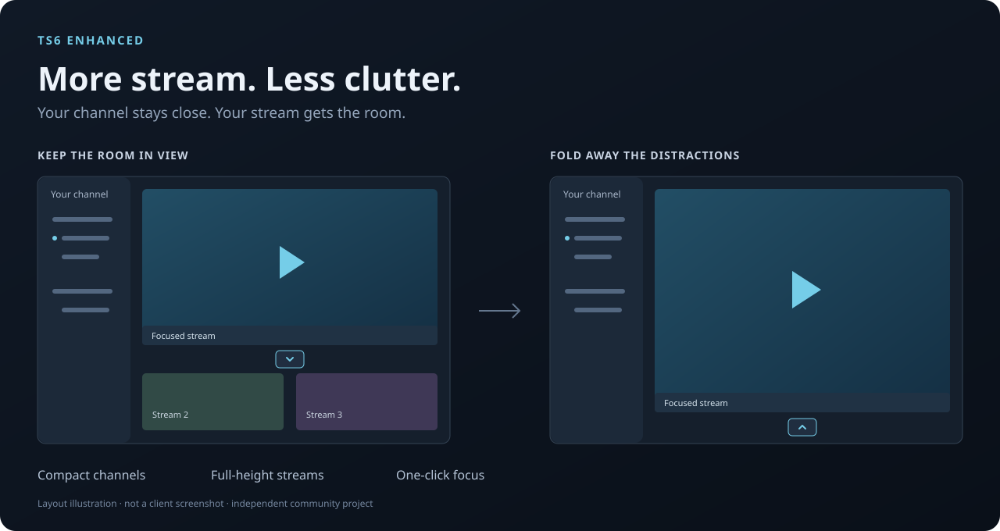

# TS6 Enhanced

More room for streams, with TeamSpeak's native navigation and voice controls.

**Preview for Windows x64 · TeamSpeak 6.0.0-beta5, build 1791901251.** The exact client build is checked before installation. This is an independent community project, not an official TeamSpeak product.



*Illustration, not a client screenshot. Colors follow your TeamSpeak appearance.*

## Features

- Focus a stream and collapse the other previews without disconnecting them.
- Keep chat visible, or hide it while messages continue updating in the background.
- See a compact sharing badge and viewer list above Start Stream.
- Adjust incoming stream volume up to 300%, with controls below the picture.
- Keep native navigation, voice controls and panel splitters, with consistent row sizing.
- Install once; manage updates and removal from the TS6 Enhanced settings icon.

Uses the official theme loader and a small local helper. No client binary patches, TS6AddonInstaller or runtime npm dependencies.

## Install

1. Run the versioned **Setup.exe** from the release package.
2. Finish active calls or streams, then click **Install**. Setup may restart TeamSpeak.
3. Open **TeamSpeak from Start Menu** for subsequent launches.

No administrator access or separate Node/PowerShell installation is needed. Missing portable runtimes are downloaded from checksum-pinned official sources. Setup supports the standard per-user installation and default profile.

This repository is still being prepared for publication. Local builds are unsigned previews; see [release readiness](docs/release-validation.md) before sharing a release.

## Update and remove

The **TS6 Enhanced** settings icon in the toolbar opens update status and uninstall. Configured builds check published GitHub releases at launch and every six hours. Downloads are verified before an explicit **Update and restart** action. Local builds have update checks disabled until a repository is configured.

Uninstall from the panel, Windows Installed apps, or the Start Menu removal entry. Fresh installs restore the appearance settings and shortcut saved before setup. Older development installs lack the original appearance baseline; removal disables the theme and preserves current preferences. Identities, bookmarks, chats and other personal data are kept.

[Installation and recovery details](docs/release-readme.md)

## Scope

The helper uses a verified local developer-tools connection on **127.0.0.1:9988** while the managed client runs. Direct EXE launches, protocol links and existing taskbar pins bypass the helper.

Browser fixtures, native-component checks and dated live tests provide different evidence. Full release installation/update/removal on a second PC, extended playback and physical DPI changes remain acceptance work. See [current release readiness](docs/release-validation.md) and the [validation history](docs/validation.md).

## Development

Use Node 22+ and PowerShell 7 on Windows:

```powershell
npm ci --ignore-scripts
npm test
npx playwright install chromium
npm run test:browser
```

Playwright is development-only and is excluded from release packages. Native-component, installer and live checks are documented separately; normal CI does not control TeamSpeak.

Release installers are built on the Windows development PC and uploaded to GitHub as drafts. See [build and upload](docs/development.md#build-locally-on-windows).

[Documentation](docs/README.md) · [Contributing](CONTRIBUTING.md) · [Changelog](CHANGELOG.md) · [MIT license](LICENSE)
